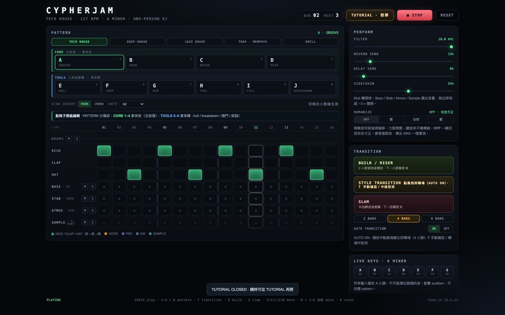
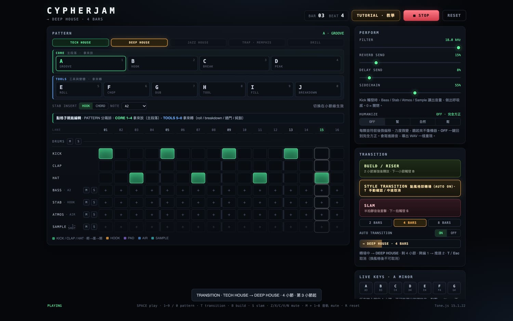

# CypherJam

**在瀏覽器裡一個人玩的 micro DJ 台。** 打開一個 HTML 檔，用鍵盤把四條軌道疊成一段 Tech House，在段落之間做 build / slam 和風格轉場。

純靜態、不需要帳號與後端，沒有建置步驟：出廠音色全部由 Web Audio 實時合成，斷網也能跑。

> A single-player micro DJ station that runs entirely in the browser. No samples, no server, no build step — all sound is synthesized live with Web Audio / Tone.js.



---

## 這是什麼

四軌十六步的 loop 網格（drums / bass / stab / atmos），加上五套風格包，每套十組 pattern。你按 `1`–`0` 換 pattern，按風格鍵換風格包，用 build 和 slam 推段落。目標不是「按下去有聲音」，而是一個人不冷場地撐二十分鐘。

適用對象：戴著有線耳機、在桌面 Chrome 前想即興放一段電子樂的人；不想學 DAW，也不想先採樣、先對拍。

**不是**：生成式音樂工具，也不是 LLM 應用。它是一套規則驅動的確定性音樂 Agent —— 排程、轉場、時序偏移都由規則決定，不用隨機數，也不呼叫任何模型。

## 核心玩法

- **不是自由編曲，是即時演奏。** 一組 pattern 就是一組現成的節奏＋和聲骨架，你在上面加減格子、推濾波器、開側鏈。
- **預設留白。** 每套風格的 A 組只有 kick 和反拍 hi-hat，其餘軌道空著等你補。
- **切換落在小節線。** 播放中按 pattern 鍵不會卡拍，換組發生在下一個小節。
- **轉場是主要表演手段。** 點風格鍵就開始自動轉場（預設 4 小節，127 BPM 約 7.5 秒）：降編 → 逐步推速 → 小節線換風格並落點重擊 → 回滿編。



上圖是 `TECH HOUSE → DEEP HOUSE` 的轉場第 3 小節：品牌欄顯示目標風格與剩餘小節，目標風格鍵全程琥珀高亮。

## 怎麼跑起來

### 線上版

- https://jvn-cypherjam.pages.dev
- https://javenzheng.github.io/cypherjam/
- 騰訊雲 CloudBase：`https://life-os-d3gh449gn80d019b7-1253754162.tcloudbaseapp.com/cypherjam/`（首次訪問會先出現風險提醒頁，需點確認）

### 本機

沒有任何依賴與建置步驟，`app/` 就是一個可跑的靜態站：

```bash
open app/index.html          # macOS，直接雙擊也可以
```

或起一個本機 server（多軌錄音需要 secure context，`localhost` 算安全來源）：

```bash
cd app && python3 -m http.server 8000
# 打開 http://localhost:8000
```

進頁面後點一次 **ENTER · START** —— 瀏覽器要求一次使用者互動才允許出聲。建議桌面 Chrome ＋ 有線耳機。

## 操作

| 鍵 | 作用 |
| --- | --- |
| `Space` | 播放 / 停止 |
| `1`–`9`、`0` | 切換 pattern（A–J）；`1`–`4` 是 CORE 主段落，`5`–`0` 是 TOOLS 工具與變體 |
| `T` | 觸發風格轉場；轉場途中可取消 |
| `Esc` | 取消待切換或進行中的轉場 |
| `B` / `S` | BUILD / RISER（2 小節）／ SLAM（靜默一個八分音符後重擊） |
| `Z` `X` `C` `V` `N` | 分軌 mute |
| `M` + `1`–`8` | 多軌音軌 mute |
| `R` | 參數復位 |

其餘操作在界面上：頂欄切風格包與開教程、右側 PERFORM 調 filter / reverb send / delay send / sidechain / 各軌 M-S、HUMANIZE 四檔、TRANSITION 長度 2 / 4 / 8 小節與 AUTO 開關。

新手教程在頂欄 **TUTORIAL · 教學**。第一次進入只自動教四步（聲音、音符、CORE-TOOLS pattern、換風格），其餘課程從選單自取；每步都檢測真實操作，可跳過。

## 技術是怎麼做的

單檔前端：`app/index.html`（約 230 KB，含全部 UI、樣式、音訊邏輯）＋ `app/vendor/Tone.js`（Tone.js 15.1.22，本地化，MIT）。沒有框架、沒有打包、沒有網路請求。

### 規則驅動的確定性 Agent

三個層次，全部是程式碼裡的規則，沒有模型推理：

- **感知層** — 讀鍵盤事件、Tone.Transport 的當前 step、小節線位置、當前風格與 pattern 狀態、各軌 mute 狀態、多軌與匯入採樣的狀態。
- **決策層** — 依規則決定：pattern 切換延到小節線、轉場分四段執行（降編 / 推速 / 換風格 / 回滿編）、Humanize 的時序偏移量、和弦是否落在 A 小調內、轉場途中 `T` 與 `Esc` 的優先級。
- **執行層** — Tone.Transport 排程、合成器發聲、混音（側鏈、send、M-S）、以及用同一份規則離線重放渲染 WAV。

**確定性**體現在兩處：Humanize 的力度與微偏移由「絕對步序號的哈希」決定，不用隨機數，所以現場與匯出走同一算法、同參數可復現；現場播放的 tick 與錄製日誌之間的誤差 ≤ 0.1 ms，離線渲染按每步絕對時間重放。

### 其它實現要點

- **出廠零取樣**：kick / clap / hat / bass / stab / pad 全是合成器與噪聲，hook 用 FMSynth 做打擊型音色。SAMPLE 軌與多軌音軌可以載入你自己的 WAV / MP3。
- **風格包是資料，不是程式分支**：一套風格 = BPM + swing + 鼓組與合成參數 + 十組 pattern + 和聲規則 + 顯示名稱。註冊時跑契約校驗，調外和弦或改調性會被直接拒絕；新增曲風不用改 UI 與鍵盤代碼。
- **錄音匯出**：現場操作寫成 step log（含 `styleIds` / `swings` / `hums` / `transitions` / `trackSteps`），再用 `Tone.Offline` 逐 step 重放渲染 16-bit WAV，可選 48 kHz / 44.1 kHz；渲染失敗退回 MediaRecorder。
- **音訊匯入**：WAV / MP3 拖入後自動裁起音、歸一化、測基頻、盡力移調到 A 小調；測不到會明確標「未自動調音」，不會假裝調過。
- **多軌音軌**：4 條 Loop Clip（跟 transport、自動測長取最近小節、IN/OUT、淡化、lowpass）＋ 4 條 Ambient Bed（不跟 BPM、獨立播放），合計上限 8；走 `masterGain`，不進 mixBus。

## 專案結構

```
app/index.html          # 全部前端：UI、樣式、音訊與排程邏輯
app/vendor/Tone.js      # Tone.js 15.1.22（MIT），本地化
docs/01-...md           # 技術選型與調研（Strudel vs Tone.js、多人同步、iOS 風險）
docs/02-...md           # v1 實現說明：架構、側鏈、低頻處理、導入、錄音、實測項
docs/03-...md           # v2：教程設計、三套風格包、swing 與鎖調
docs/04-...md           # v3 / v4：風格擴充契約、glide / tie / roll / half-time、轉場與逐 step 導出
docs/05-...md           # 路線決策與取捨記錄
docs/screenshots/       # README 用的界面截圖
PROJECT.md              # 目前完成度、實測記錄、未做清單
```

## 風格包

| 風格 | BPM | 特性 |
| --- | --- | --- |
| TECH HOUSE | 127 | 基準包，反拍 hi-hat |
| DEEP HOUSE | 122 | 較厚 pad 與低頻 |
| JAZZ HOUSE | 124 | 16 分 swing 0.35，七 / 九和弦，全部鎖在 A 小調內 |
| TRAP · MEMPHIS | 132 | half-time（`FEEL 66`），失真 808、FM 牛鈴、lo-fi 底噪；可切 140 |
| DRILL | 142 | half-time（`FEEL 71`），滑音 808（`glideMax 0.09 s`）、snare 固定第三拍 |

全曲鎖 A 小調：7 個 live pad 加上匯入採樣的自動測音 / 移調。

## 限制與已知未完成項

照實寫，避免有人以為它比實際更完整：

- **只在桌面 Chrome 上驗證過。** iOS / 手機觸控版未適配，移動端只做到版面不溢出。
- **聽感、真機、二十分鐘長跑都還沒驗。** 單元與流程都由無頭瀏覽器測過（播放步進、轉場、離線渲染、匯入調音、錄音下載等），但「好不好聽」「連續演奏會不會漂移或爆音」只能靠耳機判斷。
- **無持久化。** 沒有帳號、雲同步；pattern 與參數重新載入即失，`localStorage` 只存轉場偏好（AUTO 開關與 2 / 4 / 8 小節長度）與教程進度。
- **多軌只存在記憶體。** 頁內錄音單次上限 60 秒，重新載入消失。
- **8 條同時響時浮點峰值可到 1.43。** 匯出 WAV 靠歸一化到 0.92 避免削波，代價是整體音量被壓低。
- **噪聲類音色無法逐樣本一致。** clap / air 是噪聲合成，離線渲染的噪聲相位每次不同，所以 WAV 不是 bit-perfect 可重現（這與 Humanize 無關，Humanize 本身是確定性的）。
- **純合成鼓有上限。** 做不出 boom bap 那種取樣質感，屬材質問題，不是參數沒調好。
- **未實作**：多人 / 聯機、帳號、雲端同步、Hip Hop 風格包、手機觸控版。

## 授權

`app/vendor/Tone.js` 為 Tone.js 15.1.22，MIT 授權。其餘程式碼與文件的授權方式尚未指定。
